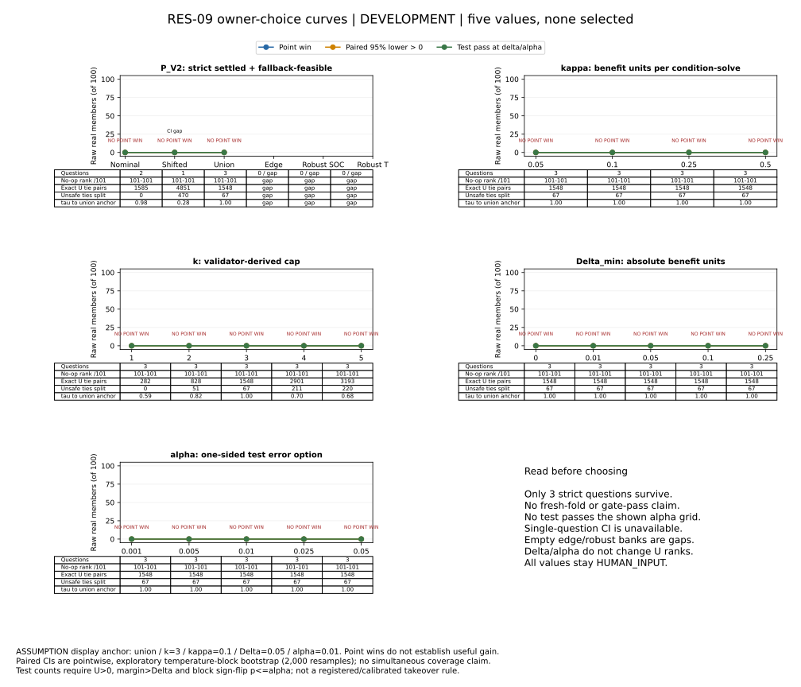

# Rev-2 value curves for the owner

**DEVELOPMENT. No values selected.** On this historical public EV4 panel,
**no real member beats the fixed bilinear cheap arm at any of the 60
population × cap × cost settings.** These are measured finite-panel counts,
not evidence about current battery-v3 decisions or customer value.

The five charts below share an arbitrary display anchor. Blue counts point
wins; orange counts positive paired confidence bounds; green counts the
illustrative paired test passing. Tables show no-op rank, ties, safety
separation and rank stability. Empty banks and unavailable intervals are gaps.

**P_V2:** enforcing “no unknown action reference” leaves just two nominal
questions and one shifted question. Edge and robust families have none.
This differs from simply counting the seven nominal and five shifted
fallback-feasible questions: most still have unresolved action references.

**κ:** the shown costs change net utility but leave the union ranking
unchanged at the display cap. They are benefit-unit charges, not measured
CPU prices. All values remain HUMAN_INPUT.

**k:** changes who ties and who ranks higher. In the union, exact U-tie pairs
rise from 282 at cap one to 3,193 at cap five; the safety tie-break splits
zero to 220 of those pairs. More verification slots do not create an edge
over this cheap arm. Abstention is exactly zero; its union rank stays 101/101.

**Δ_min and α:** affect acceptance, never the utility ranking. Neither curve
can identify a useful choice here. With three independent blocks, the
illustrative exact test has a smallest possible one-sided p-value of 0.125,
above every α shown; the singleton shifted interval is unavailable.

One additional rule needs clarification: comparing with the predicted
fallback versus its known reference objective changes 70 union member scores
at the display anchor, although neither interpretation produces a cheap-arm
winner. Mandatory G-FEAS eligibility on the new bank is unmeasured.

All counts are MEASURED (low = base = high); grids, anchor and inferential
assumptions are ASSUMPTION / HUMAN_INPUT. See [REPORT](REPORT.md) and
[results](results.json) for every setting and paired interval. The owner
retains population, cost, cap, margin and error-budget decisions.
