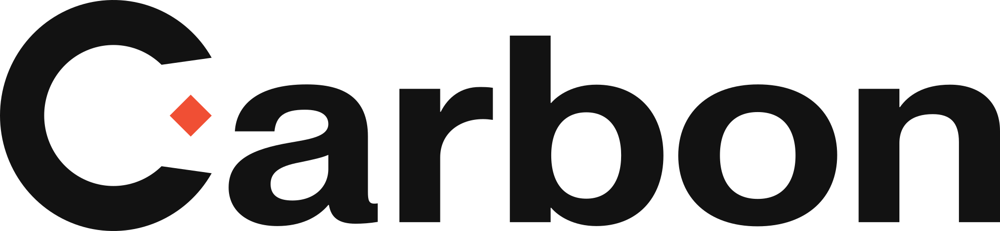

<p align="center">
  <picture>
    <source media="(prefers-color-scheme: dark)" srcset="./assets/Carbon-Light-Wordmark.svg">
    <source media="(prefers-color-scheme: light)" srcset="./assets/Carbon-Dark-Wordmark.svg">
    
  </picture>
</p>

# Carbon | Brand & Identity Guide v3

**Brand & Identity Guide / v3 · November 2026 · GitHub Repository Reference**

> **Fast physics models for engineering.** Backed by independent evaluation.
>
> Model discovery and custom physics AI development, building toward a physical intelligence platform.
>
> **Prove the work.**

> **Interactive HTML Brand Board:** GitHub's file viewer does not render `.html` pages directly. Clone or download this repository and open [`brand/Carbon-Brand-Board-v3.html`](./Carbon-Brand-Board-v3.html) locally in a browser to view the full interactive brand specimen with embedded `PP Neue Montreal` typography, composition cards, and live colour swatches.

---

## Contents

1. [01 Positioning](#01-positioning)
2. [02 Method, Loop & Current Scope](#02-method-loop--current-scope)
3. [03 Logo, Wordmark & GitHub Assets](#03-logo-wordmark--github-assets)
4. [04 Typography](#04-typography)
5. [05 Colour & Contrast](#05-colour--contrast)
6. [06 Composition & Imagery](#06-composition--imagery)
7. [07 Voice & Sample Copy](#07-voice--sample-copy)
8. [08 Claims, Disclosure, Ownership & Licensing](#08-claims-disclosure-ownership--licensing)

---

## 01 Positioning

*Lead with the physical modeling problem, the candidate model, and the decision it supports.*

### Working company description (Current)

**Carbon finds and develops fast physics models for specific engineering problems, combining competitive research with independent evaluation.**

High-fidelity simulation is accurate, yet slow runtimes limit how many designs or actions a team can test. Carbon connects scoped physical problems with competitive model discovery, isolated reconstruction, and hidden-exam evaluation to find repeatable methods that stay accurate on hard physics, hold up near limits, and transfer to unfamiliar systems.

### The engineering & platform thesis

**Predict what happens. Know when to trust it. Choose the next action.**

Fast predictions only create engineering value when their failure boundaries are known. Carbon turns physical predictions into decisions engineers can trust across design and control.

- **Primary focus:** Model discovery and custom physics AI development.
- **Platform direction:** Physical intelligence (`State → Predict → Judge → Decide → Act → Verify → Learn`).
- **Signature:** Prove the work.

> **Messaging priority:** Lead commercial and first-touch communication with fast physics models, competitive discovery, and custom model development alongside existing CAD/CAE workflows. Frame Physical Intelligence and closed-loop decision/control models clearly as the broader platform direction rather than claiming every layer is shipped today.

---

## 02 Method, Loop & Current Scope

*Separate model construction, blind testing, and decision use. State the delivery stage alongside every claim.*

### Three-part operating loop

1. **01 / Define the job: Lock the physics spec.**
   Define the physical system, required outputs, operating conditions, reference solver or measurements, and acceptance criteria. Builders see the problem specification, never the protected exam cases.
2. **02 / Discover & rebuild: Compete on methods.**
   Researchers and autonomous agents explore widely using public challenge kits via Miner Control Center and Miner MCP, submitting reproducible construction recipes that isolated workers rebuild in pinned environments.
3. **03 / Judge, verify & learn: Test blind near limits.**
   Hidden exams check mandatory physics gates, `>500x` speed gates, near-limit behavior, design transfer, and calibrated self-trust. Verified outcomes map where a method works and where it fails.

### Offerings, tracks & framing rules

| Track / Offering | Value & Role | Current Stage & Framing Rule |
| :--- | :--- | :--- |
| **Custom Model Development & Discovery** | Scope a physical modeling bottleneck around a customer's system, reference solver, and constraints to develop a fast candidate model with documented limits. | Primary commercial focus. Deliverables, IP terms, feasibility, and deployment support depend on the engagement. Do not require a standalone Evidence Audit first, and do not state that audits are discontinued. |
| **Subnet 116 Discovery Engine (Predict)** | Open competitive search and hidden-exam evaluation on Bittensor to discover repeatable physics modeling methods. | Motor 1.8 ran on Subnet 116 mainnet and is retired; each next Challenge version is announced when it opens, with its rules on its own page. Battery exited the launch set in Oct 2026; 1D Burgers is an internal pipeline testbed only. |
| **Trust & Uncertainty Layer (Judge)** | Calibrated error and limit estimates so engineers and optimizers know when to trust a fast prediction and when to run a solver. | Early live evidence. Self-trust grading (models reporting their own uncertainty and getting scored against reality) is live on mainnet; third-party standalone model auditing is not the lead commercial motion. |
| **Custom Decision & Control Models (Decide)** | Small, fast models and closed loops for active design optimization and bounded operational control (chip thermal control, robot actuator twins). | Planned direction and upcoming subnet challenges. Describe strictly as roadmap and next-on-deck research rather than deployed industrial controllers. |

> **Stage truth:** The discovery engine is running on Subnet 116. Evidence for the trust layer (self-trust and near-limit testing) is early, and custom decision models and closed control loops are plans in development. Mainnet benchmark wins do not establish customer-specific deployment fitness or formal industrial qualification.

---

## 03 Logo, Wordmark & GitHub Assets

*Use the supplied artwork. The custom C is part of the wordmark.*

### Standalone SVG assets

| Asset | Intended Surface | File |
| :--- | :--- | :--- |
| **Dark Wordmark** (`#121212` + `#F04F34`) | Light surfaces (`#F5F5F0` Mineral White, `#FFFFFF` Pure White) | [`assets/Carbon-Dark-Wordmark.svg`](./assets/Carbon-Dark-Wordmark.svg) |
| **Light Wordmark** (`#F5F5F0` + `#F04F34`) | Dark surfaces (`#121212` Carbon Black) | [`assets/Carbon-Light-Wordmark.svg`](./assets/Carbon-Light-Wordmark.svg) |
| **Dark C-Mark Logo** (`#121212` + `#F04F34`) | Light surfaces (avatars and compact placements) | [`assets/Carbon-Dark-Logo.svg`](./assets/Carbon-Dark-Logo.svg) |
| **Light C-Mark Logo** (`#F5F5F0` + `#F04F34`) | Dark surfaces (avatars and compact placements) | [`assets/Carbon-Light-Logo.svg`](./assets/Carbon-Light-Logo.svg) |

### Geometry, sizing & placement rules

- **First appearance vs. compact chrome:** Use the full wordmark for the first brand appearance. Use the C-mark for avatars and compact placements (`64px`, `40px`, `24px`, and `16px` scale ladder).
- **Protect the diamond:** Keep the inner diamond Signal Vermilion (`#F04F34`). Use a flat light or dark field behind the mark so the diamond remains visible.
- **Preserve artwork integrity:** Preserve the artwork's proportions, spacing, and colours. Do not typeset a replacement "Carbon" or add glow, outlines, or shadows.
- **Clear space & minimums:** Maintain clear space equal to one C-mark height (`1x`) on each side. Retain the `96px` / `24mm` wordmark width minimum. Inspect at final size; reserve `16px` marks for favicon testing and use `24px` or larger in interfaces.
- **Surface ink matching & legacy PNG note:** Match dark ink (`#121212`) to light surfaces and light ink (`#F5F5F0`) to dark surfaces. Note that legacy synced PNG folders include the filename `Carbon Dark Work-Mark.png`.
- **Wide social banners:** On wide social banners (such as LinkedIn `1128 × 191px`), keep the left `25%–30%` clear on `#121212` so profile avatars never overlap typography or logos.

### GitHub Markdown `<picture>` snippet (from repository root)

```html
<picture>
  <source media="(prefers-color-scheme: dark)" srcset="./brand/assets/Carbon-Light-Wordmark.svg">
  <source media="(prefers-color-scheme: light)" srcset="./brand/assets/Carbon-Dark-Wordmark.svg">
  
</picture>
```

---

## 04 Typography

*Use the supplied PP Neue Montreal files. Keep technical labels subordinate to the message.*

- **Display specimen:** `Fast physics, tested blind.`
- **Primary (`PP Neue Montreal` & `PP Neue Montreal Text`):**
  - Use **Semibold (600)** for headlines, **Regular (400)** (and **Italic 400**) for interface copy, and **PP Neue Montreal Text Book (400)** for longer reading.
  - Reserve **Extrabold (800)** for short emphasis. Hairline weights belong only in large display experiments, outside small text and social-image body copy.
  - Use `-2%` to `-4%` (`-0.02em` to `-0.04em`) tracking on large headlines and normal tracking for body copy.
  - The wordmark is vector artwork, never live-typeset text. Do not export raw `.otf` or `.woff2` font binaries as loose files in the public repository.
- **Technical / Monospace:**
  - Use monospace for run IDs, challenge IDs, physical units, axes, and evidence labels. `Neue Montreal Mono` remains the intended technical family; where unavailable (including GitHub Markdown and the standalone HTML board), use the system monospace fallback (`ui-monospace, 'SFMono-Regular', Consolas, 'Liberation Mono', monospace`).

```text
BENCHMARK / MOTOR 1.8 MAINNET
SPEED GATE / >500X VS REFERENCE SOLVER
TRUST LAYER / SELF-TRUST ACTIVE
VISUAL / ILLUSTRATIVE EXAMPLE
```

---

## 05 Colour & Contrast

*Keep the core palette. Use colour to direct attention and label real states.*

### 10-swatch brand palette

| Name | Hex | Role |
| :--- | :--- | :--- |
| **Signal Vermilion** | `#F04F34` | Diamond, arrows, emphasis, and selected boundaries. |
| **Carbon Black** | `#121212` | Dark campaigns, headlines, and body text. |
| **Mineral White** | `#F5F5F0` | Reading surfaces, light campaigns, and documents. |
| **Pure White** | `#FFFFFF` | Figures, cards, and document interiors. |
| **Graphite** | `#454547` | Secondary text and readable small labels. |
| **Steel** | `#85878C` | Decorative detail; large text only on light surfaces. |
| **Mist** | `#D8D9D4` | Dividers and supporting structure. |
| **Fine Line** | `#E8E8E3` | Quiet panels and decorative rules. |
| **Verification Green** | `#187A55` | A passed state supported by a defined test. |
| **Warning Amber** | `#A86D00` | Cautions, paired with a readable text label. |

### WCAG 2.2 contrast table

| Pair | Contrast | Text Use |
| :--- | :--- | :--- |
| Black (`#121212`) / Mineral White (`#F5F5F0`) | `17.13:1` | AA normal text |
| Graphite (`#454547`) / Mineral White (`#F5F5F0`) | `8.75:1` | AA normal text |
| Vermilion (`#F04F34`) / Mineral White (`#F5F5F0`) | `3.27:1` | AA large text only |
| Legacy Vermilion-D (`#D23A1F`) / Mineral White (`#F5F5F0`) | `4.40:1` | AA large text only |
| Steel (`#85878C`) / Mineral White (`#F5F5F0`) | `3.29:1` | AA large text only |
| Vermilion (`#F04F34`) / Carbon Black (`#121212`) | `5.24:1` | AA normal text |
| Green (`#187A55`) / Mineral White (`#F5F5F0`) | `4.86:1` | AA normal text |
| Amber (`#A86D00`) / Mineral White (`#F5F5F0`) | `3.96:1` | AA large text only |

> **Correction to v1:** Do not use Vermilion-D `#D23A1F` or Steel `#85878C` for small text on Mineral White. Use Graphite `#454547`. Keep Vermilion for accents on light surfaces; pair Vermilion fills with Carbon Black text. Calculate ratios from hex values (`4.5:1` minimum for normal text, `3:1` for large text at `24px` regular or ~`18.7px` bold). Do not round a failing ratio up to a pass, and always pair state colours with words. Reference: [W3C WCAG 2.2 Contrast (Minimum)](https://www.w3.org/WAI/WCAG22/Understanding/contrast-minimum.html).

---

## 06 Composition & Imagery

*Make the message readable at feed size. Give the wordmark and headline a shared top alignment.*

### Campaign & editorial reference copy

- **Dark campaign (`#121212` surface):**
  - Headline: **Screen designs before full solver runs.** *(Signal Vermilion underline on `full solver runs.`)*
  - Subcopy: Custom fast physics models, tested blind near physical limits.
- **Light editorial (`#FFFFFF` / `#F5F5F0` surface):**
  - Headline: **Predict the state. Know the limit.**
  - Subcopy: Documented operating bounds alongside your trusted CAE stack.

### Layout rules

- Use generous margins, a strong headline, and one supporting idea. Align the visible top of the headline with the full wordmark.
- Use an underline only when it helps hierarchy, ending at the final headline line's right edge. Leave unused corners empty.
- Centre comparison panels within the space below the subheading. Recompose `1:1` and `16:9` layouts while preserving type legibility.

### Images & motion rules

- Favor hardware-forward, high-contrast studio visuals (electric motor stators/rotors, CNC-machined liquid-cooling cold plates, structural brackets) and crisp vector geometry in monochrome with restrained Signal Vermilion accents. Keep texture out of reading areas.
- Explicitly ban crypto coin renders, neon cyberpunk palettes, glowing AI brains, and generic stock montages.
- In system and architecture diagrams, enforce 4-part visual separation:
  1. `1. Problem Spec & Reference Solver`
  2. `2. Competitive Model Discovery`
  3. `3. Isolated Rebuild & Hidden Exam`
  4. `4. Verified Decision / Customer Use`
- Give measured plots their scope, physical units, and reference source. Stamp non-measured renders or mock UI cards as `Illustrative visual` or `Illustrative example`. Do not imply scientific proof through decoration.

---

## 07 Voice & Sample Copy

*Speak with direct technical and commercial clarity. Match every statement to supported evidence.*

### Sample copy blocks

- **Engineering & commercial:**
  > High-fidelity solvers can take hours per run. Carbon finds and develops custom fast physics models around your reference solver, tested blind on cases the builders never saw.
- **Discovery & hidden exams:**
  > Most AI models are graded by the teams that built them. On Carbon, researchers submit reproducible recipes, isolated workers rebuild them, and hidden near-limit exams decide what holds up.
- **Platform direction:**
  > Prediction tells you what might happen; decisions create the value. Carbon is building from fast physics predictors toward calibrated trust and verified engineering choices.

### Account voice alignment & editorial bans

- **Carbon (Company voice):** Direct, technical, and objective. Leads with the physical problem, model discovery, and scoped evaluation results.
- **Nick Fitzpatrick:** Commercial and buyer-focused on LinkedIn and X. Connects fast physics models to design-space screening, CAE workflow fit, and engineering decisions.
- **Ryan Bequette:** Grounded in aerospace verification and subnet engineering on X and technical deep dives. Explains build mechanics, failure boundaries, and verification rigor.
- **Editorial bans:** Zero em dashes anywhere in copy (use periods, commas, colons, or parentheses, and `→` for process flows). Avoid AI hype language, rhetorical-question openers, dramatic one-word fragments, habitual three-part cadences, and unrequested emojis or hashtags.

---

## 08 Claims, Disclosure, Ownership & Licensing

*Match every public statement to its verified technical or commercial record.*

### Audience & network framing: Bittensor is public; lead buyers with physics.

Carbon's discovery engine on Bittensor (Subnet 116) is live and public; the pre-reveal restriction from v2 is retired. With commercial engineering buyers, lead with the physical modeling bottleneck, CAE workflow fit, and tested operating limits, treating Subnet 116 as the research engine under the hood and keeping token mechanics out of customer openings. With miners, researchers, and network participants, explain challenge rules, recipe reconstruction, and emission decay/burn mechanics clearly. Never publish miner income forecasts or promise token returns, and keep Carbon Physics, Inc. corporate revenue distinct from token economics.

### Evidence & claim boundaries: Publish the supported claim.

Separate external literature speedups (such as `1,000x` neural operator papers) from Carbon's own challenge gates (`>500x` speed pass mark) and scoped mainnet results (such as Motor 1.8's `0.11%` full-waveform error, `0.03%` mean torque error, and learned-model error reductions within that motor topology). Do not imply signed commercial customers, paid pilots, recurring revenue, or deployed control loops without approved records. Use `"Passed Physics Gates"` or `"Independently Evaluated"` rather than bare `"Qualified"` labels that imply formal industrial certification. Never expose hidden exam cases, future seeds, unreleased audit logs, or private customer CAD.

### Ownership & licensing

| Responsibility | Owner / Boundary |
| :--- | :--- |
| **Brand, commercial & participant positioning** | **Nick Fitzpatrick**, Co-founder, CMO & COO. Owns brand identity, voice, commercial messaging priority, participant product framing, and announcement timing. |
| **Technical architecture & delivery claims** | **Ryan Bequette**, Co-founder & CEO. Confirms subnet architecture, runtime capabilities, customer delivery feasibility, and shipped product status. |
| **Scientific ML & validation claims** | **Hiran Sen**, Scientific ML Lead. Reviews challenge physics scope, reference solver baselines, uncertainty/self-trust calibration, and scientific result interpretation. |
| **Repository & trademark licensing** | **Carbon Physics, Inc.** Subnet software in this repository is MIT-licensed (see `LICENSE`). The Carbon name, custom C-mark, wordmark, `brand/`, `Business/`, `website/`, and `presentations/` are proprietary to Carbon Physics, Inc. and are excluded from the MIT License. |

---

*Brand & Identity Guide v3 · November 2026 · Carbon Physics, Inc. · Prove the work.*
